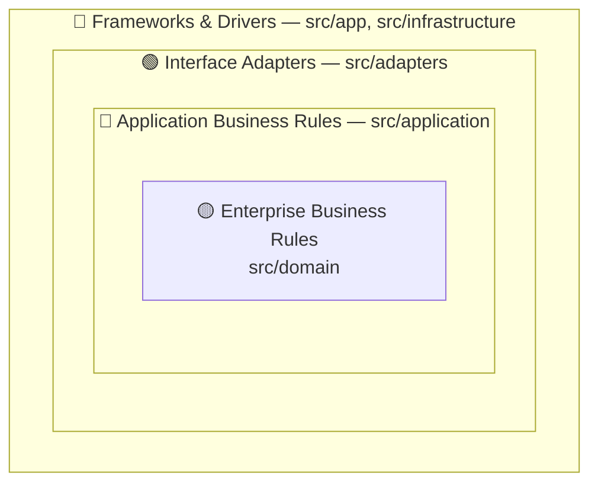
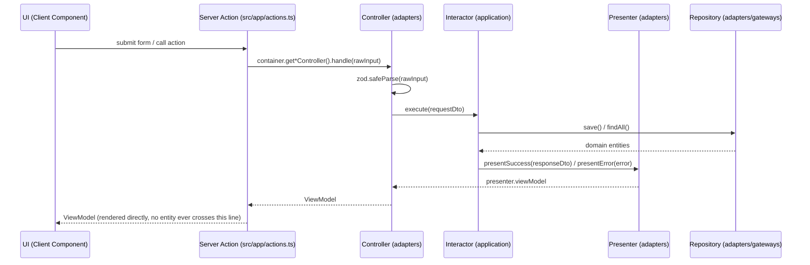

# Architecture

Collect is built as Uncle Bob's Clean Architecture, implemented literally as
four concentric folders under `src/`, with Next.js Server Actions as the only
way the UI reaches into the system (there is no separate backend).

## The four rings



| Ring | Folder | Contains |
|---|---|---|
| 🟡 Entities | `src/domain` | `Collection` entity, `CollectionId`/`Money` value objects, domain errors. Zero imports outside itself. |
| 🔴 Use Cases | `src/application` | `CreateCollectionInteractor`, `ListCollectionsInteractor`, their input/output ports, and the `CollectionRepository` gateway interface. Imports only `domain`. |
| 🟢 Interface Adapters | `src/adapters` | Controllers (Zod validation), Presenters (ViewModels), Gateways (`InMemoryCollectionRepository`, `DrizzleCollectionRepository`). Imports only `application` and `domain`. |
| 🔵 Frameworks & Drivers | `src/infrastructure`, `src/app` | Drizzle client/schema, env parsing, the DI composition root, and all Next.js code (Server Actions, pages, components). |

## The Dependency Rule

Source code dependencies point **inward only**. Concretely:

- `domain` imports nothing — no Next, no Zod, no Drizzle, no `process.env`, no Node core modules.
- `application` imports only `domain`.
- `adapters` imports only `application` and `domain`. The one carve-out: a
  Gateway may import `infrastructure/db/schema.ts` to know the table shape it
  maps rows to/from, and may import the driver library it wraps
  (`drizzle-orm`) to build queries — but it never imports a *live* client,
  config, or the DI container. The client instance always arrives through
  the gateway's constructor.
- `infrastructure` may import any inner ring.
- `app/` imports only `infrastructure/di` (to get controllers) and adapter
  ViewModel types (presenters). It never imports use cases, entities, ports,
  or repositories directly.

### Enforcement

`pnpm lint:arch` runs `dependency-cruiser` against `.dependency-cruiser.cjs`,
which encodes every rule above as a `forbidden` dependency pattern. It fails
the build on any inward-rule violation.

`src/app/__architecture-violation-fixture.ts` has a commented-out import of
`CreateCollectionInteractor` directly into `src/app`. Uncomment both lines in
that file (the import must actually be referenced, or TypeScript elides it
before dependency-cruiser ever sees the edge) and run `pnpm lint:arch` to
watch it fail:

```
error app-no-application: src/app/__architecture-violation-fixture.ts → src/application/use-cases/collections/create-collection.interactor.ts
```

Re-comment both lines afterwards.

Test files (`*.test.ts`) are exempt from these rules on purpose: a unit test
for an interactor wires the real `InMemoryCollectionRepository` and a fake
presenter directly, crossing from `application` into `adapters`. That cross
is the proof the architecture works without a framework — not a violation
of it.

## Request flow

Every Server Action follows the same five-step path, matching Uncle Bob's
diagram:



1. A **Server Action** (`'use server'`) is thin: pull raw input, get a
   controller from `infrastructure/di/container.ts`, call it, return the
   ViewModel. No business logic.
2. The **Controller** validates with Zod, builds a request DTO (plain data,
   plus any adapter-generated fields like the new UUID and `createdAt`), and
   calls the **Input Port** (the interactor).
3. The **Interactor** builds/loads `Collection` entities through the
   **Repository** port, then calls the **Output Port** (the presenter) with
   either a response DTO or lets a thrown `DomainError` be presented as an
   error.
4. The **Presenter** turns that into a serializable **ViewModel** —
   formatted currency strings, user-facing error messages. No entities or
   value objects ever leave this step.
5. UI components (`CollectionForm`, `CollectionList`) receive ViewModels
   only.

## Why a repository is a singleton but controllers are not

`infrastructure/di/container.ts` caches one `CollectionRepository` instance
for the process lifetime (so a `Collection` created in one Server Action call
is visible to a `List` call in the next), but builds a **new** presenter +
interactor + controller on every `get*Controller()` call, because a
presenter's `viewModel` is per-call state — reusing one across concurrent
requests would leak data between them.
